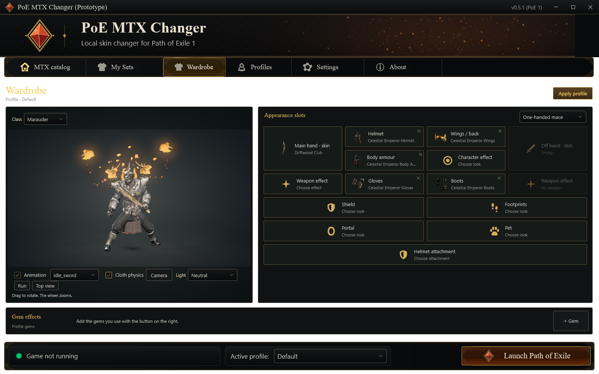
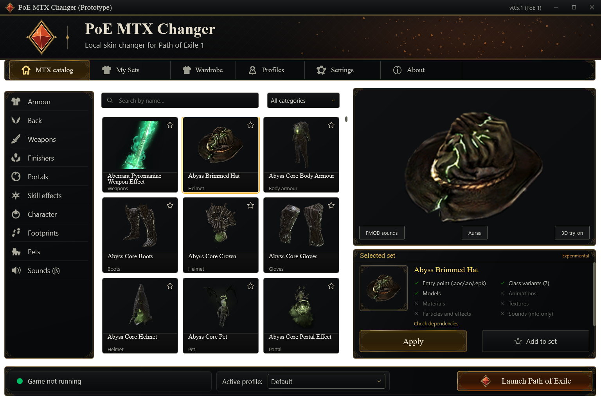



# PoE MTX Changer

Try on and swap Path of Exile 1 cosmetics on your own PC. 
The changes are local: only you see them.

[Install](#install) · [What it does](#what-it-does) · [Oodle](#oodle) · [Changelog](CHANGELOG.md) · [Report a bug](https://github.com/nevertheminder/poe-mtx-changer/issues/new/choose)

 

> [!WARNING]
> Changing game files is against GGG's terms of use and can get your account actioned. This tool is not "ban-safe".
> A game update or Steam's file check removes the changes.

## What it does

- **Catalog** of every shop cosmetic in your game, with names and icons.
- **3D wardrobe**: put a set together and see it on your character, with effects, glow and moving capes.
- **Apply** the set to your game files, and **restore** the originals with one click.
- **Skill effects and auras** for the gems you use, and **sound** replacements.
- **Profiles** to keep several sets.

## Install

You need Windows 10 or 11 (64-bit), Path of Exile 1, and the
[.NET 10 Desktop Runtime](https://dotnet.microsoft.com/download/dotnet/10.0).

1. Download the zip from [Releases](../../releases) and extract it anywhere.
2. Close the game and run `PoeMtxChanger.exe`.
3. Pick items in the **catalog**, try them on in the **Wardrobe**, then click **Apply profile**.

To undo everything, close the game and click **Restore originals** in **About**.

### Oodle

The game's files are packed with Oodle (`oo2core_*_win64.dll`). Its licence does not allow shipping it with this app,
but it is free: install **Unreal Engine** with the [Epic Games Launcher](https://www.unrealengine.com/download) and the
app finds it by itself. If a game on your PC already has an `oo2core_*_win64.dll`, you can also choose that file in
**Settings**. Without Oodle the app cannot read or change game files.

## Privacy

No telemetry and no internet access. Settings, profiles, logs and backups stay in `%AppData%\PoeMtxChanger\`.

## Feedback and contributing

Found a bug, or something looks different from the game? Open an issue: the forms ask for what is needed.
See [CHANGELOG.md](CHANGELOG.md) for changes, [CONTRIBUTING.md](CONTRIBUTING.md) to build the app or send a pull
request, and [SECURITY.md](SECURITY.md) for security problems.

## Licence

All rights reserved: you may read the code, but not copy, change or share it without permission. Game files, Oodle
and FMOD are not included; the app reads them from your own installation. Third-party libraries are listed in
[THIRD-PARTY-NOTICES.md](THIRD-PARTY-NOTICES.md).

*Path of Exile* and its logo are trademarks of Grinding Gear Games. This project is not affiliated with Grinding
Gear Games.
